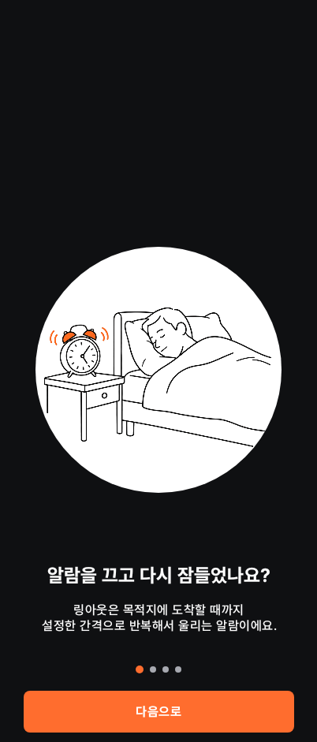
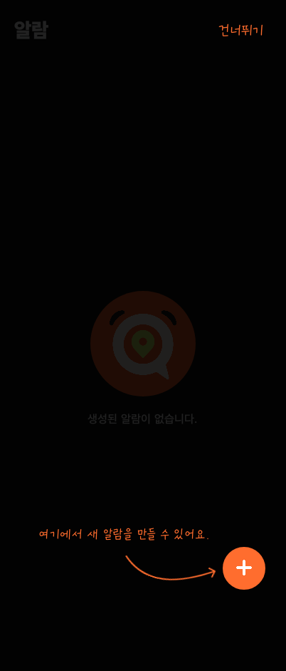
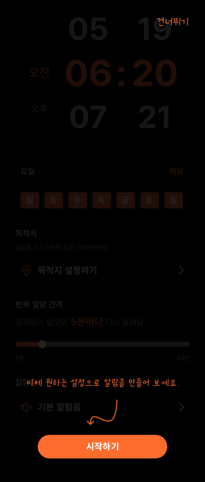
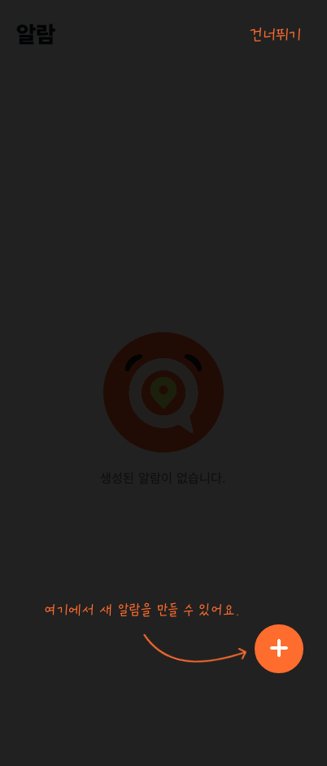
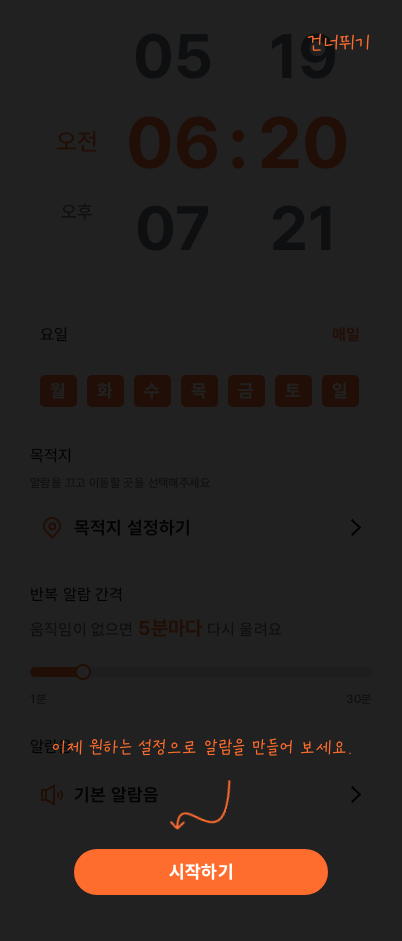

# 서비스 소개 온보딩과 알람 생성 가이드

Android Compose UI 테스트에서 캡처한 402×941 화면입니다. `OnboardingScreenTest`와 `AlarmCreationGuideTest`의 테마별 화면 검증 결과를 PR 검토용으로 보관합니다.

| 테마 | 서비스 소개 | 첫 홈 안내 | 마지막 시작하기 |
| --- | --- | --- | --- |
| 다크 |  |  |  |
| 라이트 |  |  |  |

- 홈에서는 강조된 알람 추가 버튼을 눌러 작성 화면으로 이동합니다.
- 시간·요일·목적지·반복 간격·알람음 안내는 화면 어디를 눌러도 다음 안내로 넘어가며 실제 설정을 바꾸지 않습니다.
- 마지막에는 `시작하기` 버튼을 눌러 가이드만 종료합니다. 알람은 자동으로 저장하지 않습니다.
- 건너뛰기나 뒤로가기로도 가이드를 종료할 수 있습니다. 종료 후에는 기존 화면에서 자유롭게 설정합니다.
