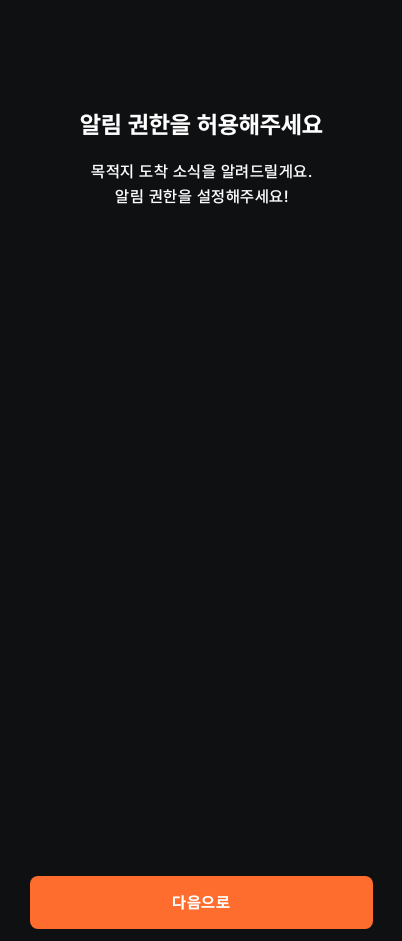

# 서비스 소개 온보딩과 알람 생성 가이드

Android Compose UI 테스트에서 캡처한 402×941 화면입니다. `OnboardingScreenTest`와 `AlarmCreationGuideTest`의 테마별 화면 검증 결과를 PR 검토용으로 보관합니다.

| 테마 | 서비스 소개 | 첫 홈 안내 | 마지막 시작하기 |
| --- | --- | --- | --- |
| 다크 |  |  |  |
| 라이트 |  |  |  |

- 홈에서는 강조된 알람 추가 버튼을 눌러 작성 화면으로 이동합니다.
- 시간·요일·목적지·반복 간격·알람음 안내는 화면 어디를 눌러도 다음 안내로 넘어가며 실제 설정을 바꾸지 않습니다.
- 마지막에는 `시작하기` 버튼을 눌러 가이드만 종료합니다. 알람은 자동으로 저장하지 않습니다.
- 건너뛰기나 뒤로가기로도 가이드를 종료할 수 있습니다. 종료 후에는 기존 화면에서 자유롭게 설정합니다.

## 위치·알림 권한 안내

서비스 소개 4단계 뒤에 위치 권한 → 일반 알림 권한 화면을 순서대로 표시합니다. 아래 이미지는 Android Compose 호스트 테스트에서 캡처한 앱 콘텐츠이며, 시스템 상태바·권한 팝업·설정 앱은 포함하지 않습니다.

| 테마 | 위치 권한 | 알림 권한 |
| --- | --- | --- |
| 다크 |  |  |
| 라이트 |  |  |

- [다크 위치 화면](https://www.figma.com/design/AoRETtkXoDQFXgF544UFIo?node-id=855-7068)과 [라이트 위치 화면](https://www.figma.com/design/AoRETtkXoDQFXgF544UFIo?node-id=855-7125)의 배치·색상·버튼을 적용했습니다. 알림 화면의 위치 설명 중복은 알림 용도에 맞게 수정했습니다.
- 권한 페이지가 완전히 표시되면 요청 가능한 권한을 최초 한 번 자동 요청합니다. 이미 허용되어 있으면 `다음으로`를 눌러 시스템 팝업 없이 진행합니다.
- 거부 후 화면 재구성·앱 복귀·재방문만으로 요청을 반복하지 않습니다. 재시도 또는 설정 이동은 같은 화면의 버튼으로 진행합니다.
- 위치는 정확한 위치 사용을 기준으로 확인합니다. 거부하거나 위치 서비스가 꺼져 있으면 같은 화면에 남아 재시도 또는 설정 이동을 안내합니다.
- 설정에서 돌아오면 실제 권한 상태를 다시 확인합니다. 두 권한을 허용한 뒤에만 온보딩 완료를 저장하고 기존 홈 가이드로 이어집니다.
- 소개 단계는 기존 페이지 표시점과 스와이프를 유지합니다. 권한 단계에는 표시점을 노출하지 않으며 스와이프와 연속 입력으로 동의를 건너뛸 수 없습니다.
- 테스트에는 양 테마, 320×568 화면과 200% 글자 크기, 거부·재시도·중복 응답·설정 복귀·Android Activity 재생성·iOS 권한 브리지 시나리오가 포함됩니다.
