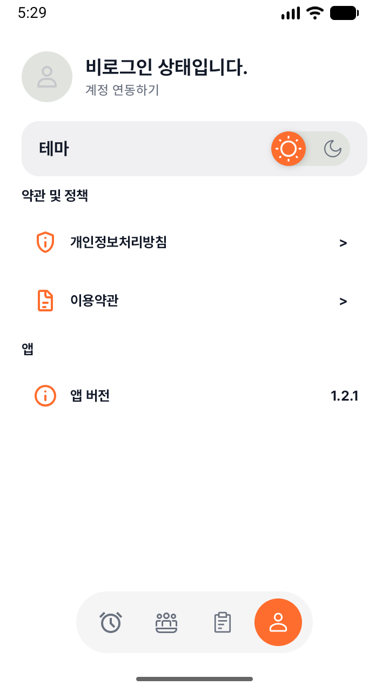

# Android Studio에서 로컬 Release 실행

`localRelease`는 Release 빌드에 로컬 디버그 서명을 사용하는 명시적인 옵션이다.
최적화·리소스 축소·개발자 도구 제외는 유지한다. 스토어 배포용으로 사용하지 않는다.
서버 환경을 바꾸지 않으며 `RINGOUT_API_BASE_URL`이 없으면 개발 서버에 연결한다.

## Android Studio

1. `client/local.properties`에 `localRelease=true`를 추가한다. 기존 SDK 경로와 앱 키는 유지한다.
2. `MAPS_API_KEY`, `KAKAO_NATIVE_APP_KEY`와 `androidApp/google-services.json`을 준비한다.
3. Gradle Sync를 실행한다.
4. **Build Variants**에서 `androidApp`의 **release**를 선택한다.
5. 에뮬레이터를 선택하고 **Run**으로 실행한다. Release는 디버거 연결용 빌드가 아니다.

`local.properties`는 Git에서 제외되어 있다. 옵션을 제거하거나 `false`로 바꾸고 Sync하면
기존 배포용 서명 설정으로 돌아간다. 배포용 설정이 없으면 빌드가 실패하며 자동으로 디버그 서명하지 않는다.

## 명령어와 모드 구분

프로젝트의 `client` 폴더에서 실행한다.

```bash
# local.properties 설정을 사용하여 APK 생성
./gradlew :androidApp:assembleRelease

# 명령어에서만 로컬 서명을 명시적으로 선택
./gradlew :androidApp:assembleRelease -PlocalRelease=true

# 로컬 설정을 덮어쓰고 기존 배포용 서명 설정 검증
./gradlew :androidApp:validateReleaseConfiguration -PlocalRelease=false
```

| 모드 | 서명 | 앱 키 | Crashlytics 매핑 업로드 |
| --- | --- | --- | --- |
| 기본 | 배포용 키 필수 | 실제 설정 필수 | 사용 |
| `localRelease=true` | 로컬 디버그 키 | 실제 설정 필수 | 끔 |
| `ciVerification=true` | 없음 | 검증용 설정 | 끔 |

`-PlocalRelease`는 `local.properties`보다 우선한다. `ciVerification=true`는
로컬 서명 옵션보다 우선하므로 기존 CI 검증 결과물은 계속 unsigned로 생성된다.
로컬 Release에서도 개발자 도구 제외 검사가 실행된다.

## 설치 및 서비스 확인

- 명령어 빌드 결과물: `androidApp/build/outputs/apk/release/androidApp-release.apk`
- IDE에서 기기를 지정한 실행 빌드는 `androidApp/build/intermediates/apk/release/`에 생성될 수 있다.
  개발자 도구 검증은 AGP가 제공한 결과물 경로와 APK 메타데이터를 사용한다.
- 기존 앱과 applicationId가 같으므로 동시에 설치되지 않는다.
- 같은 디버그 키로 서명한 Debug 앱에는 데이터 유지 업데이트가 가능하다.
  기존 앱의 서명이 다르면 설치가 거부된다. 이 경우 자동으로 앱을 삭제하지 말고 별도 에뮬레이터를 사용한다.
- 지도·로그인 서비스에는 사용하는 디버그 인증서의 지문/키 해시 등록이 필요할 수 있다.
- 이 옵션은 서명과 매핑 업로드만 바꾼다. Analytics/Crashlytics의 런타임 수집 설정은 변경하지 않는다.

## 실행 확인 화면

로컬 디버그 키로 서명한 Release APK를 에뮬레이터에 설치한 화면이다.
마이페이지에 앱 버전은 표시되며 개발자 도구 진입점은 표시되지 않는다.
코드 제외 여부는 별도의 APK/AAB 검사로 확인한다.


